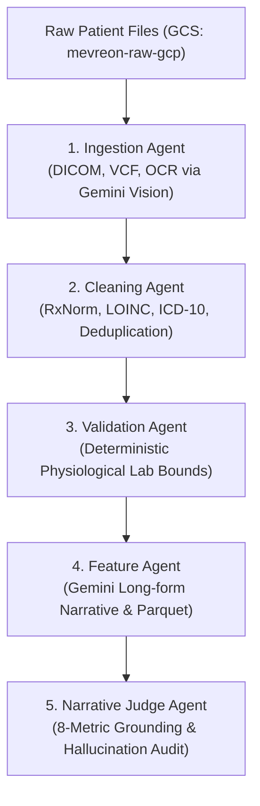

# Mevreon Platform — Google Cloud Deployment & Architecture Guide

## 🚀 Overview

Mevreon is an agentic clinical data engineering platform deployed on **Google Cloud Platform (GCP)**. It parses heterogeneous patient medical records (radiology DICOM series, scanned clinical PDFs, genomic VCFs, lab panels), executes a 5-stage deterministic validation pipeline, and synthesizes grounded longitudinal patient stories and interactive clinical dashboards.

---

## 🌐 Live Deployed Endpoints

* **Frontend Web App (Cloud Run):**  
  [https://mevreon-gcp-frontend-1077656215528.us-central1.run.app](https://mevreon-gcp-frontend-1077656215528.us-central1.run.app)
* **Backend API Gateway (Cloud Run):**  
  [https://mevreon-gcp-backend-1077656215528.us-central1.run.app](https://mevreon-gcp-backend-1077656215528.us-central1.run.app)
* **Health Check:**  
  `GET https://mevreon-gcp-backend-1077656215528.us-central1.run.app/api/health`
* **GCP Project:** `mevreon` (Project Number: `1077656215528`, Region: `us-central1`)

---

## 🔑 Clinical Authentication

When launching the web application, login via the **Secure Clinical Login** modal:

* **Access Key ID:** `MEVREON-GCP-ACCESS-2026`
* **Secret Access Key:** `Yk7pQ2mVn9Rt4wXz8eB6cH3jF5sA1d0q`

*(Or Admin Email: `admin@mevreon.ai` / Password: `Mevreon123!`)*

Credentials mint a signed JSON Web Token (JWT) that is saved to browser `localStorage` (`mevreon_v7_auth`). Subsequent requests authenticate using `Authorization: Bearer <token>`.

---

## 🏥 Architecture & Cloud Storage (GCS) Buckets

The pipeline organizes clinical files into tiered Google Cloud Storage buckets:

| Bucket Name | Purpose |
| :--- | :--- |
| `mevreon-raw-gcp` | Ingested patient files (`.pdf`, `.dcm`, `.vcf`, `.docx`, `.xlsx`, `.jpg`) |
| `mevreon-staging-gcp` | Raw structured extractions and layout-aware OCR text tokens |
| `mevreon-processed-gcp` | Ontologically cleaned (RxNorm, LOINC, ICD-10) and validated records |
| `mevreon-curated-gcp` | Final outputs (`DASHBOARD.json`, `JUDGE_REPORT.json`, `master_data.parquet`, narratives) |
| `mevreon-memory-gcp` | Pipeline run metadata and execution state tracking (`runs/<run_id>/__status.json`) |
| `mevreon-quarantine-gcp` | Rejected, corrupt, or unparseable files |

---

## ⚙️ 5-Agent Processing Pipeline



---

## 🛠️ Deploying Updates

All deployment steps are automated via the unified deploy script:

```bash
cd "Mevreon gcp"

# Deploy everything:
./deploy/gcp.sh all

# Or deploy specific tiers:
./deploy/gcp.sh build-backend
./deploy/gcp.sh deploy-backend
./deploy/gcp.sh job
./deploy/gcp.sh build-frontend
./deploy/gcp.sh deploy-frontend
```
